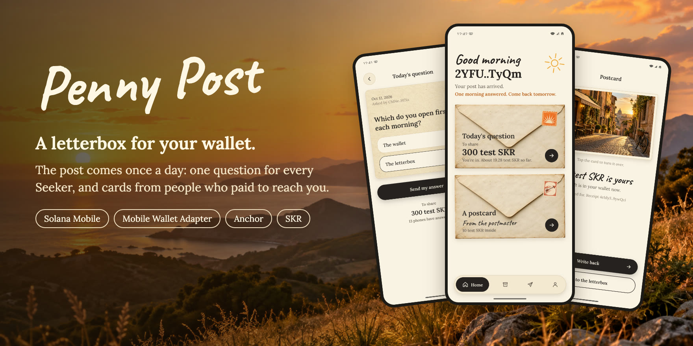
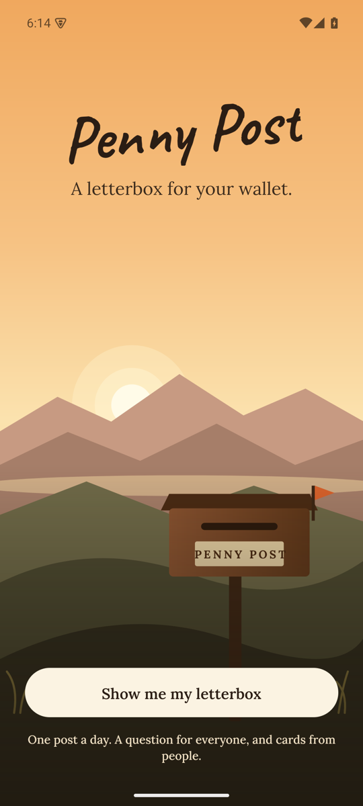
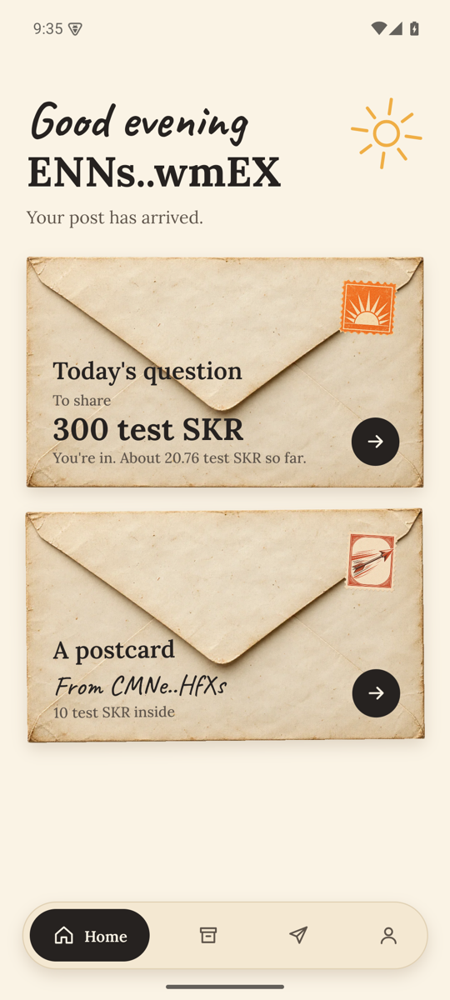
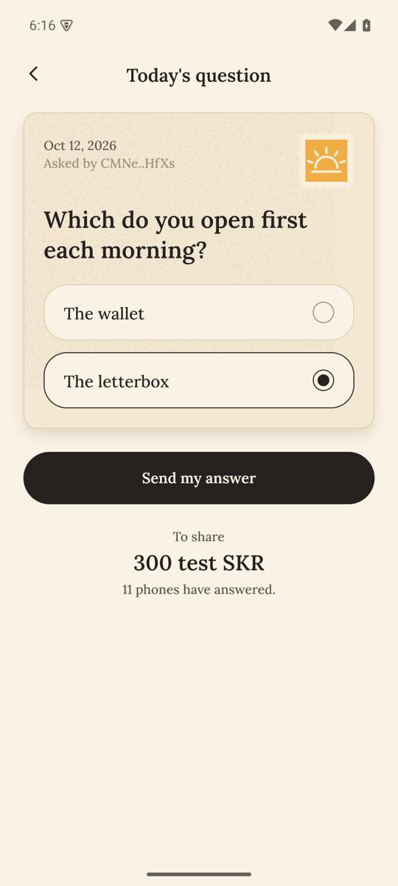
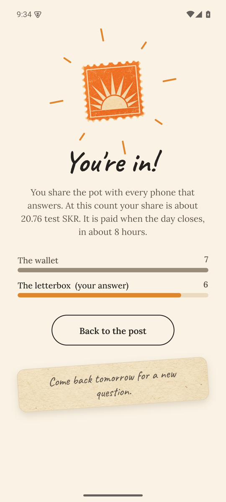
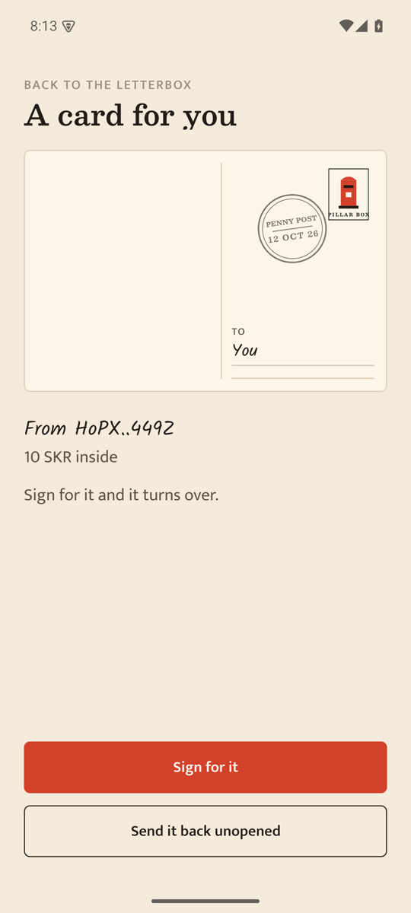
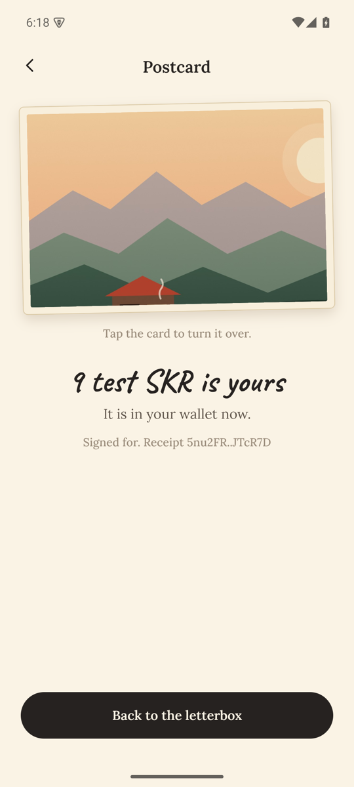

# Penny Post



A letterbox for every `.skr` name.

Every Seeker came with an address. Penny Post lets people write to it. The post comes once a day, at eight in the morning where the reader lives. Friends write for free. Anyone else pays postage in SKR, and the postage goes to the reader when they turn the card over. And every day there is one card for everyone: a question that any Seeker can answer once, with a pot that the phones who answered share.

In 1840 the Penny Post made the sender pay for a letter instead of the person receiving it. Here the sender still pays, and the reader keeps the postage. This is an entry for [Clock In](https://solanamobile.radiant.nexus/), the third Solana Mobile hackathon.

The [pitch deck](docs/penny-post-deck.pdf) is twelve pages, and the [APK](https://github.com/kinnuworks/penny-post/releases/download/v1.0.0/penny-post.apk) installs on any Android phone.

<p>
  
  
  
  
  
  
</p>

These are from the signed release build, running on an Android emulator against the devnet deployment.

## How it works

1. You open a letterbox with one signature. It records your wallet, a key for sealed letters, and your price.
2. You write a card: a photo on the front, your handwriting on the back, a stamp in the corner.
3. A phone that holds a Seeker Genesis Token gets one free stamp a day. The stamp is counted against the token, so one phone gets one stamp however many wallets it uses.
4. Anyone without a free stamp pays the reader's price. The postage waits in a vault that belongs to that one card.
5. At 08:00 in the reader's time zone the card arrives. When the reader signs for it, 90% of the postage is theirs and 10% is burned.
6. A card nobody opens goes back to its sender after seven days, postage and rent included.
7. Once a day there can be a circular: one question put to every Seeker. Whoever asks puts up a pot in SKR. Each Genesis Token answers once, and when the day closes the phones that answered share the pot equally, less the 10% burn. If nobody answers, the pot goes back.

A letterbox takes three paid cards a day at most, and the reader sets the price. Cards from strangers never carry a link you can tap.

## What is built

| Part                                                                                                  | State                                                                                                                                                                                                                                                                                                                                                                                                                                          |
| ----------------------------------------------------------------------------------------------------- | ---------------------------------------------------------------------------------------------------------------------------------------------------------------------------------------------------------------------------------------------------------------------------------------------------------------------------------------------------------------------------------------------------------------------------------------------- |
| `anchor/programs/penny_post`: the program, twelve instructions                                        | Builds for Solana. 31 unit tests and 54 end-to-end tests pass on a fork of mainnet, against the real SKR mint and six real Genesis Tokens. Deployed to devnet on 12 October 2026.                                                                                                                                                                                                                                                              |
| Genesis Token check inside the program                                                                | Tested on a real mint and on real holdings, one full and one emptied.                                                                                                                                                                                                                                                                                                                                                                          |
| App: wallet connect, letterbox, writing a card, posting, signing for a card, sending back, kept cards | Run end to end on an Android emulator with Solana Mobile's reference wallet, against a local fork of mainnet. Not run on a physical phone yet.                                                                                                                                                                                                                                                                                                 |
| Sealed letters                                                                                        | A sealed card was posted, fetched and opened on the emulator. Unit tested.                                                                                                                                                                                                                                                                                                                                                                     |
| `.skr` lookup, both directions                                                                        | Matches AllDomains' own library on mainnet.                                                                                                                                                                                                                                                                                                                                                                                                    |
| Free daily stamp for Seeker owners                                                                    | The app found a real Genesis Token placed in the emulator's wallet, the program verified it, and a free card was posted on it. Not run on a Seeker.                                                                                                                                                                                                                                                                                            |
| The circular: one question a day for every Seeker                                                     | Asked, answered by nine phones and tallied on the emulator. Collecting, outbidding and refunds are tested end to end.                                                                                                                                                                                                                                                                                                                          |
| `supabase/functions/cards`: the card store                                                            | Deployed. Its refusals are tested. Accepting a card is not, because that needs the program on a network.                                                                                                                                                                                                                                                                                                                                       |
| `supabase/functions/exchange`: the pen-pal exchange                                                   | Deployed. Its refusals are tested. Matching two writers is not, for the same reason.                                                                                                                                                                                                                                                                                                                                                           |
| The 08:00 bell                                                                                        | Written. The planning is unit tested, and the app asks for notification permission on a device. A bell has not been seen ringing yet.                                                                                                                                                                                                                                                                                                          |
| Changing your price from the letterbox                                                                | Changed on the emulator from 10 to 25 SKR, and the next card paid the new price.                                                                                                                                                                                                                                                                                                                                                               |
| A dry run before the wallet opens                                                                     | Every transaction is simulated first, and a refusal is shown as a plain sentence. Tested end to end for six refusals, and it runs ahead of every prompt on the emulator.                                                                                                                                                                                                                                                                       |
| Release build, signed from a keystore in the environment                                              | Builds for arm64, about 58 MB, signed with the release key. Every flow in this table was run from that build on an Android emulator. Not installed on a physical phone yet.                                                                                                                                                                                                                                                                    |
| Home-screen widget                                                                                    | Not started.                                                                                                                                                                                                                                                                                                                                                                                                                                   |
| Devnet and mainnet deployment                                                                         | On devnet at `D5LZ7kUmpXhE2hsKHnse9itthWHX6j8o4EkGcfz2MLAD`, with the post office open since 12 October 2026 and a question scheduled for each of the next 20 days. SKR and the Genesis Token are stand-ins there. From the release build on an emulator, against devnet, a new wallet took a test kit, put up a letterbox, verified its stand-in Genesis Token, answered the day's question and signed for a paid card. Mainnet: not started. |

This table is kept honest. If a row says "not started", it is not in the build.

## Try it on devnet

Install [the APK](https://github.com/kinnuworks/penny-post/releases/download/v1.0.0/penny-post.apk) on any Android phone. No wallet app is needed: on the first screen choose "Try it with a practice one", and the app makes a throwaway devnet wallet on the phone. Then tap "Set me up". One tap takes a test kit (a little SOL, 300 stand-in SKR and a stand-in Genesis Token), puts up a letterbox and shows the token to the program. A welcome card lands a few seconds later. Answer the day's question, open the card, and write back.

To use your own wallet instead, set it to devnet and choose "Show me my letterbox". Every signature then goes through Mobile Wallet Adapter.

Everything on devnet is a stand-in with no value. The program is the same one that would run on mainnet, and it checks a stand-in Genesis Token exactly as it checks a real one.

## Run it

You need Node 20 or newer, pnpm, JDK 17, the Android SDK, and an Android phone with a Solana wallet installed. Expo Go will not work, because Mobile Wallet Adapter needs a development build.

```bash
pnpm install
```

```bash
npx -y solana-mobile@latest doctor
```

```bash
pnpm run android
```

App tests and checks:

```bash
pnpm test
```

```bash
pnpm run ci
```

The program needs the Rust, Solana and Anchor toolchains, and Surfpool for the end-to-end tests. `anchor:unit` runs the Rust unit tests. `anchor:test` starts a local validator that forks mainnet and runs all three test files in order.

```bash
pnpm run anchor:unit
```

```bash
pnpm run anchor:test
```

To open the post office on a network once the program is deployed there:

```bash
pnpm post-office open --cluster devnet
```

To run everything on one machine, with an emulator or a phone on USB and no real network: start a validator that forks mainnet, open the post office on it, start the stand-in card store, and point a development build at them. `pnpm pen-pal` plays the other side: it writes to the phone, asks the day's question and has other phones answer it. It takes `--cluster localnet`, `devnet` or `mainnet`.

```bash
pnpm run anchor:localnet
```

```bash
pnpm post-office open --cluster localnet
```

```bash
pnpm local-card-store
```

```bash
adb reverse tcp:8899 tcp:8899 && adb reverse tcp:8787 tcp:8787
```

```bash
EXPO_PUBLIC_LOCALNET_RPC_URL=http://localhost:8899 EXPO_PUBLIC_CARD_STORE_URL=http://localhost:8787 npx expo start --dev-client
```

A release APK for arm64, signed with your own keystore. The four `PENNY_POST_` variables it reads are listed at the top of `plugins/with-release-signing.js`.

```bash
pnpm run android:release
```

## The program

| Instruction        | Who signs         | What it does                                                                                                            |
| ------------------ | ----------------- | ----------------------------------------------------------------------------------------------------------------------- |
| `open_post_office` | Upgrade authority | Runs once. Fixes the postage token and the Genesis Token group for good.                                                |
| `set_terms`        | Admin             | Changes the floor price, the express fee and the burn share (20% ceiling).                                              |
| `open_letterbox`   | Reader            | Creates the reader's letterbox with a reading key, price and time zone.                                                 |
| `set_letterbox`    | Reader            | Changes those three settings.                                                                                           |
| `verify_letterbox` | Reader            | Proves the wallet holds a Genesis Token and ties its seal to the letterbox.                                             |
| `post_card`        | Sender            | Creates the card and its vault, and moves postage into the vault. A free card must show the Genesis Token.              |
| `open_card`        | Reader            | Pays the reader, burns the share, closes the card and vault.                                                            |
| `return_card`      | Anyone, or reader | Refunds the sender after expiry, or earlier if the reader sends it back.                                                |
| `post_circular`    | Sponsor           | Puts a question to every Seeker for one UTC day and holds the pot. Can take over a day not yet begun with a larger pot. |
| `answer_circular`  | Seeker owner      | Records one answer for the wallet's Genesis Token.                                                                      |
| `collect_circular` | Seeker owner      | After the day closes, pays that phone its equal share, less the burn.                                                   |
| `close_circular`   | Anyone            | Clears a finished circular. Refunds the sponsor if nobody answered.                                                     |

Choices worth knowing about:

- Each card has its own vault and the card account is the vault's authority. There is no shared pool.
- On mainnet no server holds a key or a token, and the app ships no API key. On devnet one function holds a wallet of test tokens to hand to visitors, and nothing else. The card store accepts a card's contents only if their SHA-256 is the hash of a card that already exists on-chain. Sealed letters reach it already encrypted.
- `post_card` pins the reader's letterbox address by its seeds, so a sender cannot leave it out to dodge the reader's price.
- A sender never pays more than they agreed to. They name the postage and the highest express fee in their own transaction, and a card keeps the burn share it was posted under.
- `open_card` and `return_card` empty the vault by its real balance. Sending stray tokens to a vault cannot lock a card.
- The Genesis Token check reads the mint's `TokenGroupMember` extension and the holder's token account by hand, and only after confirming Token-2022 owns both. A real Genesis Token sits frozen in its account, and the check allows for that. The free stamp is keyed on the token's mint, as Solana Mobile's own guidance says it should be.

- An answer to a circular lives at an address made from the Genesis Token's mint. A second answer from the same token has nowhere to go, whichever wallet tries. The app hides the count until a phone has answered, and nothing is paid for picking the popular answer, so there is no reason to follow the crowd.

See [SECURITY.md](SECURITY.md) for the threat model and what has not been reviewed.

## Stack

Expo development build, React Native, `@solana/kit`, `@wallet-ui/react-native-kit` for Mobile Wallet Adapter, Uniwind for styling, Anchor for the program and Codama for its typed client. It started from Solana Mobile's `expo-kit-anchor` template.

## License

Apache-2.0. See [LICENSE](LICENSE).
